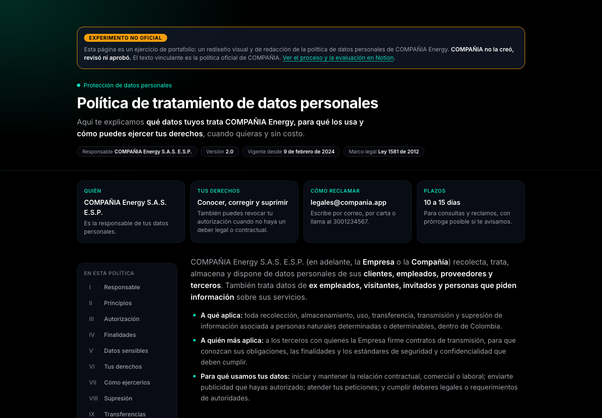
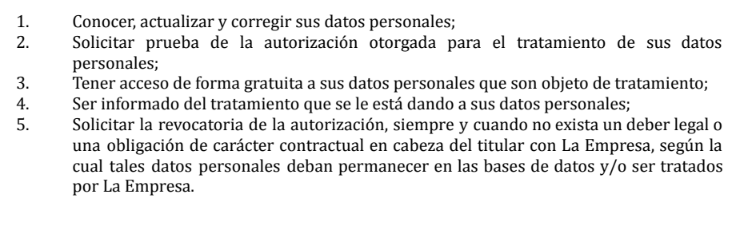
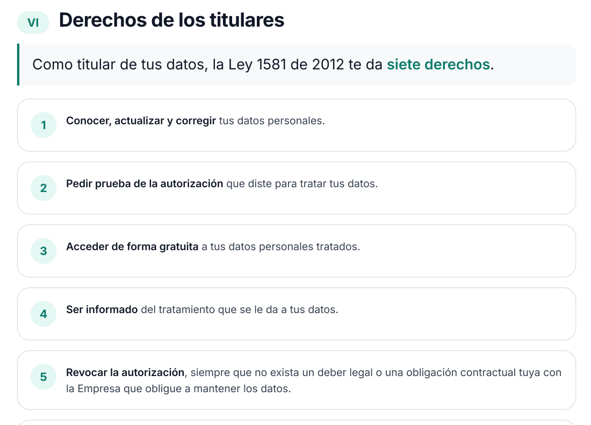

Trabajé con la política de datos de una empresa de energía. Por confidencialidad no uso su nombre ni su marca.

*Vista de escritorio de la política rediseñada. [Ver el artefacto](https://claude.ai/artifact/AxkS2aZbZw1vuAmQTuF3YC).*

## 1. Problema

La experiencia de usuario también se mide por la distancia entre lo fácil que es usar el producto y lo difícil que es leer sus «rincones».

Hablo de los términos y condiciones y de las políticas del sitio. Son documentos que casi nadie lee, pero la persona los acepta cuando deja sus datos.

En este caso, la política era un PDF de 9 páginas, con párrafos largos y sin jerarquía. **El look también era ajeno al producto**: tipografía, color y tono no se parecían al resto de la marca.

## 2. Hipótesis

Si acorto las frases y doy jerarquía, la política se lee más fácil sin tocar las obligaciones legales.

Lo mediría con dos índices de lecturabilidad en español. Si el puntaje no sube, la hipótesis falla.

## 3. Experimento

Rediseñé el documento con los tokens del producto y principios de UX writing.

- **Resumen inicial** de cuatro tarjetas: quién, derechos, cómo reclamar y plazos.
- **Una frase simple** al inicio de cada una de las 12 secciones.
- **Índice lateral** con la sección activa, y listas con la idea clave en negrita.
- **PDF imprimible** con fondo blanco, porque el tema oscuro no sirve para imprimir.

Medí con Fernández-Huerta e INFLESZ, sobre el texto extraído del PDF original y del HTML nuevo. Los dos usan el largo de frases y de palabras.

Mismo contenido, antes y después. Los PDF completos, con los datos de la empresa ocultos: [original](/lab/politica-datos-original.pdf) y [rediseñado](/lab/politica-datos-rediseno.pdf).

## 4. Resultado

La lecturabilidad mejoró unos 10 puntos, casi todo por las frases cortas.

| | Original | Nueva |
|---|---|---|
| Palabras | 3.364 | 1.962 (−42 %) |
| Palabras por frase | 25,1 | 11,3 |
| Fernández-Huerta | 48,3 (difícil) | 58,0 (bastante difícil) |
| INFLESZ | 43,7 (algo difícil) | 53,0 (cerca de «normal») |

Lo que no funcionó:

- **Vocabulario legal intacto:** INFLESZ no llega a «normal», porque los términos correctos siguen siendo largos.
- **Medición sesgada:** títulos y bullets cuentan como frases, lo que infla la mejora.
- **Textos no equivalentes:** el nuevo es 42 % más corto.
- **Sin personas:** no hay prueba con usuarios, solo índices.
- **Fecha inconsistente:** el original dice 2023 en el encabezado y 2024 en el cuerpo.

## 5. Aprendizaje

Acortar frases mueve el puntaje; simplificar términos legales es otro trabajo.

Un índice mide forma, no comprensión. La próxima vez **guardaría el script de medición** y definiría desde el inicio cómo contar las frases. Medí con un script de un solo uso, así que no se puede repetir con cada versión.

## 6. Siguiente paso

Falta lo que sí prueba el efecto en las personas.

- **Revisión de legal** contra el original, para confirmar que no se perdió ninguna obligación.
- **Prueba de tareas con 5 a 8 personas**, por ejemplo: «¿cuántos días tiene la empresa para responder un reclamo?».
